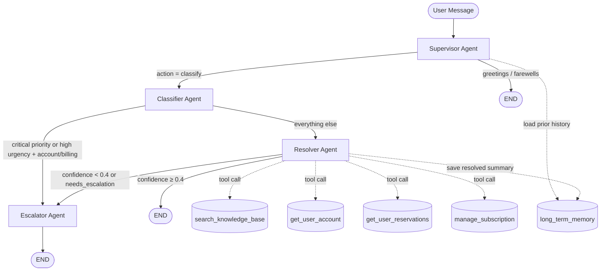

# UDA-Hub — Multi-Agent Customer Support System

UDA-Hub is an intelligent customer support agent built with **LangGraph** for the CultPass Card platform. It uses a **Supervisor Pattern** with four specialised agents to classify, resolve, and escalate support tickets — backed by a RAG knowledge base, live account lookup tools, persistent memory, and structured JSON logging.

---

## Architecture



| Agent | Responsibility | Key output fields |
|---|---|---|
| **Supervisor** | Decides if the message is a support issue or small talk; loads LTM for returning customers | `next_action`, `long_term_context` |
| **Classifier** | Labels ticket type, urgency, and complexity | `classification`, `urgency`, `complexity` |
| **Resolver** | KB retrieval + account tools + grounded answer generation; saves LTM on success | AI reply, `confidence`, `retrieval_quality` |
| **Escalator** | Crafts empathetic escalation message with a `UDA-*` ticket reference | Escalation reply |

### Routing Rules

After classification, `route_after_classifier` applies three prioritised escalation rules before handing off to the Resolver:

| Rule | Condition | Route |
|---|---|---|
| 1 | `ticket_priority == "critical"` | Direct → Escalator |
| 2 | `urgency == "high"` and `category in (account, billing)` | Direct → Escalator |
| 3 | `urgency == "high"` and `complexity == "complex"` | Direct → Escalator |
| 4 | Everything else | → Resolver |

---

## Project Structure

```
solution/
├── agentic/
│   ├── agents/
│   │   ├── supervisor.py       # Routes + loads long-term memory for returning customers
│   │   ├── classifier.py       # Labels category, urgency, complexity
│   │   ├── resolver.py         # RAG + tool calls + confidence scoring + LTM save
│   │   └── escalator.py        # Empathetic escalation with UDA-* ticket ref
│   ├── tools/
│   │   ├── knowledge_tools.py  # search_knowledge_base — keyword RAG over udahub.db
│   │   └── account_tools.py    # get_user_account, get_user_reservations, manage_subscription
│   ├── llm.py                  # Centralised LLM factory (Vocareum proxy)
│   ├── logging_config.py       # JsonFormatter + configure_logging() for structured JSON logs
│   └── workflow.py             # LangGraph StateGraph — custom graph, no prebuilt agents
├── data/
│   ├── core/
│   │   └── udahub.db           # Generated: accounts, knowledge, tickets, long-term memory
│   ├── external/
│   │   ├── cultpass.db         # Generated: users, subscriptions, experiences, reservations
│   │   ├── cultpass_users.jsonl
│   │   ├── cultpass_experiences.jsonl
│   │   └── cultpass_articles.jsonl   # 14 knowledge base articles
│   ├── models/
│   │   ├── cultpass.py         # SQLAlchemy ORM: User, Subscription, Experience, Reservation
│   │   └── udahub.py           # SQLAlchemy ORM: Account, Knowledge, Ticket, LongTermMemory
│   └── repositories/           # Database abstraction layer (tools call these, not raw SQL)
│       ├── __init__.py
│       ├── base.py             # get_connection() context manager — commit/rollback/close
│       ├── account_repo.py     # get_user() → UserAccount dataclass
│       ├── reservation_repo.py # get_reservations() → list[Reservation]
│       ├── subscription_repo.py# update_subscription() → SubscriptionUpdate dataclass
│       └── ltm_repo.py         # save_memory(), get_customer_memories(), extract_customer_id()
├── tests/
│   ├── test_workflow.py        # 68 tests (57 unit + 11 integration), zero live API calls for unit suite
│   └── check_db.py             # Inspect row counts for both databases
├── 01_external_db_setup.ipynb  # Populate cultpass.db
├── 02_core_db_setup.ipynb      # Populate udahub.db + knowledge base
├── 03_agentic_app.ipynb        # Interactive chat interface
├── utils.py                    # get_session, chat_interface helpers
├── README.md
├── DOCUMENT.md                 # Layman explanation + 14 agentic concepts
├── EVALS.md                    # Evaluation framework (9 dimensions)
└── requirements.txt
```

---

## Quick Start

### 1. Install dependencies

```bash
pip install -r requirements.txt
```

### 2. Configure your API key

Copy `.env.example` to `.env` and add your Vocareum API key:

```
OPENAI_API_KEY=voc-xxxxxxxxxxxxxxxxxxxxxxxxxxxxxxxxxxxxxxxx
OPENAI_BASE_URL=https://openai.vocareum.com/v1
```

### 3. Set up the databases

Run the notebooks **in order** in Jupyter, or use the plain-Python alternative:

```bash
py run_setup.py
```

This creates two SQLite databases:

**`data/external/cultpass.db`** — the CultPass platform data

| Table | Rows | Description |
|---|---|---|
| `users` | 6 | Alice, Bob, Cathy, David, Eva, Frank (2 blocked) |
| `experiences` | 7 | Cultural experiences with location, date, premium flag |
| `subscriptions` | 6 | One per user — active, paused, or cancelled; basic or premium |
| `reservations` | 8 | Spread across non-blocked users (1–2 each) |

**`data/core/udahub.db`** — the UDA-Hub support system data

| Table | Rows | Description |
|---|---|---|
| `accounts` | 1 | CultPass Card account record |
| `knowledge` | 14 | Support articles (RAG source) |
| `tickets` | 1 | Sample open ticket |
| `ticket_metadata` | 1 | Status, tags, issue type |
| `ticket_messages` | 1 | First user message |
| `long_term_memory` | 0→n | Populated at runtime — one row per resolved session |
| `users` | 1 | UDA-Hub user linked to the CultPass account |

### 4. Run the agent

Open `03_agentic_app.ipynb` in Jupyter and run all cells. Use any of these test messages to exercise the system:

```
"I can't log in — I never get the password reset email."
"My email is bob.stone@granite.com, I want to cancel my subscription."
"Why was I charged twice last month?"
"I think my account has been compromised."
"How do I make a reservation?"
```

---

## How It Works

### Knowledge Retrieval (RAG)

The Resolver calls `search_knowledge_base` first on every ticket:

1. Tokenise the query — stop words removed
2. Score every article: `title_match × 3 + tag_match × 2 + content_match × 1`
3. Filter to articles scoring `≥ MIN_RELEVANCE_SCORE` (3.0)
4. Return top 3 articles; embed `<<ESCALATION_REQUIRED>>` marker if none qualify
5. Resolver detects the marker → deterministic escalation (no second LLM call needed)
6. If articles found, LLM generates a grounded answer with a `confidence` score (0.0–1.0)
7. Escalate if `confidence < 0.4` or `needs_escalation=True`

### Memory

| Type | Mechanism | Scope |
|---|---|---|
| Short-term | `MemorySaver` checkpointer keyed by `thread_id` | Within a single chat session |
| Long-term | `LongTermMemory` table in `udahub.db`, managed by `ltm_repo.py` | Across sessions, keyed by customer email |

**Save:** After a successful resolution, the Resolver extracts the customer identifier from any account-tool call made during the session and writes a compact JSON summary to `long_term_memory`.

**Retrieve:** At the start of each new session, the Supervisor scans the customer's message for an email address. If found, it queries `long_term_memory` and injects prior resolved-issue summaries as `long_term_context` into the shared agent state.

### Database Abstraction Layer

Tools never open database connections directly. All SQL lives in `data/repositories/`:

| Repository | Function | Returns |
|---|---|---|
| `account_repo` | `get_user(db, identifier)` | `UserAccount` dataclass |
| `reservation_repo` | `get_reservations(db, user_id)` | `list[Reservation]` |
| `subscription_repo` | `update_subscription(db, user_id, action)` | `SubscriptionUpdate` dataclass |
| `ltm_repo` | `save_memory()` / `get_customer_memories()` | — / `list[str]` |

The shared `base.py` `get_connection()` context manager handles commit, rollback, and connection close automatically.

### Structured Logging

Every agent emits structured JSON logs via `agentic/logging_config.py`. Logs are written to **`logs/udahub.log`** (created automatically) and also to stderr. Each line is a self-contained JSON object:

```json
{"timestamp": "2026-11-02T10:42:33.801+00:00", "level": "INFO", "agent": "supervisor", "event": "user_query", "status": "received", "thread_id": "session-abc123", "message": "User query: I can't log in to my CultPass account"}
{"timestamp": "2026-11-02T10:42:34.120+00:00", "level": "INFO", "agent": "supervisor", "event": "route", "status": "success", "thread_id": "session-abc123", "message": "Supervisor routed to classify"}
{"timestamp": "2026-11-02T10:42:35.880+00:00", "level": "INFO", "agent": "classifier", "event": "classify", "status": "success", "message": "Classified as technical / urgency=low / complexity=simple"}
{"timestamp": "2026-11-02T10:42:37.210+00:00", "level": "INFO", "agent": "resolver", "event": "tool_call", "tool_name": "search_knowledge_base", "status": "success", "thread_id": "session-abc123", "message": "Tool invoked: search_knowledge_base"}
{"timestamp": "2026-11-02T10:42:39.560+00:00", "level": "INFO", "agent": "resolver", "event": "resolve", "status": "success", "thread_id": "session-abc123", "message": "Resolver: confidence=0.85, escalate=False, retrieval_quality=high"}
```

**Log events emitted per agent:**

| Agent | `event` | `status` | When |
|---|---|---|---|
| Supervisor | `user_query` | `received` | Every incoming message |
| Supervisor | `route` | `success` / `error` | After routing decision |
| Classifier | `classify` | `success` | After labelling |
| Resolver | `tool_call` | `success` | Each tool invoked |
| Resolver | `resolve` | `success` / `escalated` | After answer generation |
| Resolver | `escalate` | `escalated` | ESCALATION_MARKER detected |
| Escalator | `escalate` | `escalated` | Ticket created |

Fields present on every record: `timestamp`, `level`, `logger`, `message`. Fields present when set: `agent`, `event`, `tool_name`, `status`, `thread_id`.

### Available Tools

| Tool | Source DB | Purpose |
|---|---|---|
| `search_knowledge_base` | `udahub.db` | Keyword-scored RAG over 14 support articles |
| `get_user_account` | `cultpass.db` | Account + subscription status by ID or email |
| `get_user_reservations` | `cultpass.db` | Booking history with experience details |
| `manage_subscription` | `cultpass.db` | Cancel or pause a subscription; persists to DB |

---

## Example Flows

```
User: "I can't log in to my account"
→ Supervisor: classify
→ Classifier: technical / medium / simple
→ Resolver: search_knowledge_base("login account access") → articles found
           confidence 0.85 → ✅ resolved

User: "My account was hacked and I'm being charged for things I didn't book"
→ Supervisor: classify
→ Classifier: account / high / complex
→ route_after_classifier: high urgency + account → direct escalation (no Resolver)
→ Escalator: "Your case UDA-ACC-HIG has been escalated to our team…" 📩

User (returning, email in message): "Hi, email is bob.stone@granite.com, billing question"
→ Supervisor: detects email → loads LTM → long_term_context populated
→ Classifier: billing / low / simple
→ Resolver: uses LTM context to personalise answer → saves new summary to LTM
```

---

## Running Tests

```bash
pytest tests/test_workflow.py -m "not integration" -v
```

**57 unit tests, zero live API calls required** for the non-integration suite. 11 additional integration tests (tagged `@pytest.mark.integration`) require a valid `.env` and populated databases. Total: 68 tests.

### Test Coverage by Area

| Test class | Tests | What it covers |
|---|---|---|
| `TestDatabaseSetup` | 6 | DB files exist, table schema, article counts |
| `TestKnowledgeTools` | 6 | RAG retrieval correctness, `ESCALATION_MARKER`, `MIN_RELEVANCE_SCORE` |
| `TestAccountTools` | 4 | Tool responses, invalid action rejection |
| `TestClassifierAgent` | 3 | Output fields, ticket metadata in prompt |
| `TestRoutingDecisions` | 8 | All `route_after_classifier` rules (pure unit, no LLM) |
| `TestSupervisorAgent` | 2 | Routing and greeting handling |
| `TestRepositoryLayer` | 7 | Structured return types, cancel/pause DB-state, restore fixtures |
| `TestResolverToolIntegration` | 2 | Resolver dispatches correct tool names via `_run_tools` spy |
| `TestLongTermMemory` | 6 | Save/retrieve round-trip, customer scoping, email extraction, LTM wiring |
| `TestAgentStateIntegration` | 7 | State shape correctness, fallback on LLM error, escalation flag |
| `TestErrorHandling` | 3 | Missing DB → safe error string; LLM down → safe fallback |
| `TestStructuredLogging` | 2 | `JsonFormatter` output is valid JSON with correct fields |
| `TestEndToEnd` *(integration)* | 7 | Full state + escalation + KB assertions; `next_action`, `retrieval_quality`, `confidence`, `UDA-` ref |
| `TestCompleteTicketWorkflow` *(integration)* | 4 | Structured log capture — routing, tool_call, resolve, escalate events verified end-to-end |

---

## Tech Stack

| Layer | Technology |
|---|---|
| Agent orchestration | LangGraph `StateGraph` (custom graph, no prebuilt agents) |
| LLM | OpenAI `gpt-4o-mini` via Vocareum proxy |
| Tool binding | LangChain `@tool` + `bind_tools()` |
| Structured output | Pydantic + `with_structured_output()` |
| Databases | SQLite accessed via repository pattern (dataclasses) |
| ORM models | SQLAlchemy 2.0 declarative base |
| Short-term memory | LangGraph `MemorySaver` checkpointer |
| Long-term memory | `long_term_memory` SQLite table + `ltm_repo.py` |
| Logging | Python `logging` + custom `JsonFormatter` |
| Testing | pytest |
