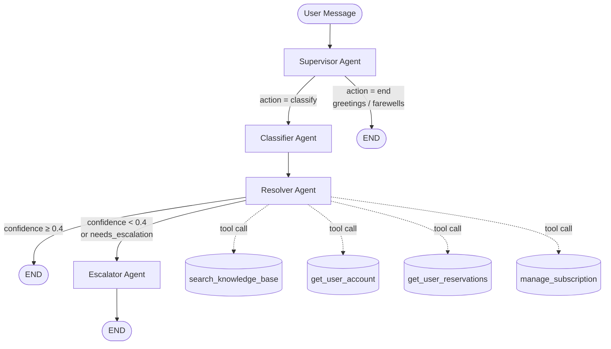

# UDA-Hub Architecture Design

## Overview

UDA-Hub is an intelligent, multi-agent customer support system built with **LangGraph**.
It plugs into the CultPass Card platform to classify, route, resolve, and escalate support
tickets — leveraging a knowledge base (RAG), account lookup tools, and session-persistent
memory.

---

## Multi-Agent Graph (Supervisor Pattern)



---

## Agent Roles and Responsibilities

| Agent | Role | Key output |
|---|---|---|
| **Supervisor** | Entry point. Decides if the message is a support issue or small talk. | `next_action` = `classify` or `end` |
| **Classifier** | Categorises the ticket type and urgency level. | `classification`, `urgency` |
| **Resolver** | Calls tools to retrieve knowledge and account data; generates a response with a confidence score. | `messages[-1]` (AI reply), `confidence`, `next_action` |
| **Escalator** | When the resolver cannot confidently answer, crafts an empathetic escalation message with a reference number and SLA. | `messages[-1]` (escalation reply) |

---

## State Schema

```python
class AgentState(TypedDict):
    messages: Annotated[list[BaseMessage], add_messages]
    classification: str      # billing | technical | account | booking | general
    urgency: str             # low | medium | high
    confidence: float        # 0.0 – 1.0
    next_action: str         # classify | end | escalate
    long_term_context: str   # cross-session customer history (future)
```

---

## Routing Logic

```
START
  └─► Supervisor
        ├─ action="classify" ──► Classifier ──► Resolver
        │                                          ├─ confidence ≥ 0.4  ──► END  ✅
        │                                          └─ confidence < 0.4  ──► Escalator ──► END  📩
        └─ action="end" ──► END  💬
```

---

## Knowledge Retrieval (RAG)

**Retrieval strategy:** Keyword-based relevance scoring over the `knowledge` table in
`data/core/udahub.db`.

1. **Tokenise** the user query (remove stop words).
2. **Score** each article: `title_match × 3 + tag_match × 2 + content_match × 1`.
3. **Return top-3** articles above score threshold.
4. **Generate response**: The Resolver LLM receives the retrieved articles as context
   and produces a final answer with a self-assessed confidence score.
5. **Escalate** when confidence < 0.4 or no articles were retrieved.

---

## Memory

| Type | Mechanism | Scope |
|---|---|---|
| **Short-term** | `langgraph.checkpoint.memory.MemorySaver` with `thread_id` | Within a session (conversation continuity) |
| **Long-term** | `LongTermMemory` table in `udahub.db` | Across sessions (future expansion) |

Short-term memory lets the agent remember what was said earlier in the same chat
session without repeating context. Long-term memory stores resolved summaries and user
preferences keyed by `thread_id` for returning customers.

---

## Tools

| Tool | Database | Purpose |
|---|---|---|
| `search_knowledge_base` | `udahub.db › knowledge` | RAG retrieval of support articles |
| `get_user_account` | `cultpass.db › users + subscriptions` | Account & subscription status lookup |
| `get_user_reservations` | `cultpass.db › reservations + experiences` | Booking history lookup |
| `manage_subscription` | `cultpass.db › subscriptions` | Cancel or pause a subscription |

All tools use absolute paths computed relative to the `solution/` root — no hardcoded paths,
no imports from outside `solution/`.

---

## Decision Flow Example

```
User: "I can't log in to my account"

Supervisor  → classify
Classifier  → category=technical, urgency=medium
Resolver    → calls search_knowledge_base("login account access")
            → retrieves "How to Handle Login Issues" + "How to Reset Your Password"
            → confidence=0.85
            → returns answer directly  ✅

User: "I want to dispute a charge on my card"

Supervisor  → classify
Classifier  → category=billing, urgency=high
Resolver    → calls search_knowledge_base("dispute charge billing")
            → retrieves "Refund and Dispute Policy"
            → confidence=0.35  (dispute requires manual review)
            → needs_escalation=true
Escalator   → "Your case UDA-BIL-HIG has been escalated…"  📩
```

---

## Inputs and Outputs

| Input | Description |
|---|---|
| Natural language ticket | User's support message via `chat_interface()` |
| Ticket ID / thread ID | Identifies the session for short-term memory |
| CultPass user ID / email | Optional; enables account-specific tool calls |

| Output | Description |
|---|---|
| AI response | Resolution or escalation message |
| Classification | Category + urgency stored in `AgentState` |
| Confidence score | Internal signal for routing; not shown to user |

---

## Project Structure

```
solution/
├── agentic/
│   ├── agents/          # Supervisor, Classifier, Resolver, Escalator
│   ├── design/          # This document
│   ├── tools/           # knowledge_tools.py, account_tools.py
│   └── workflow.py      # Custom LangGraph StateGraph (no prebuilt)
├── data/
│   ├── core/            # udahub.db (generated)
│   ├── external/        # cultpass.db (generated), JSONL seed files
│   └── models/          # SQLAlchemy ORM models
├── tests/               # pytest test cases
├── 01_external_db_setup.ipynb
├── 02_core_db_setup.ipynb
├── 03_agentic_app.py    # Entry point
├── utils.py
└── requirements.txt
```

---

## Dependencies

See [`requirements.txt`](../requirements.txt).  
Key packages: `langgraph`, `langchain-openai`, `sqlalchemy`, `pydantic`, `pytest`.

Python version: ≥ 3.11
